# Mirage for humanoid perception: an independent evaluation

This repo is a hands-on evaluation of [`Cactus-Compute/mirage`](https://huggingface.co/Cactus-Compute/mirage), a 51.3M-parameter on-device vision model (2-bit weights, Apache-2.0). It asks one question: **can Mirage serve as the perception layer of a humanoid robot, or handle its basic perception tasks?**

Mirage returns objects (boxes and masks), OCR text, relations, a scene summary and form answers (`extract()`) in one call. Its vendor publishes speed and size figures, but no accuracy benchmarks. This repo provides measured numbers, the raw model outputs and the scripts, so others can compare Mirage with their own models on the same images.

Not affiliated with Cactus Compute. All results were measured on one x86 laptop (details below). Corrections and results from other hardware are welcome.

| Where | What |
|---|---|
| **GitHub (this repo)** | Code, scripts, full write-up, issues |
| **Hugging Face:** [shivpratapsingh/mirage-humanoid-perception-benchmark](https://huggingface.co/datasets/shivpratapsingh/mirage-humanoid-perception-benchmark) | Browsable table of the 300 test images (photo, ground truth, Mirage and YOLO26n outputs), loadable with `datasets`, plus all files |
| **Kaggle:** [sspanwar/mirage-humanoid-perception-benchmark](https://www.kaggle.com/datasets/sspanwar/mirage-humanoid-perception-benchmark) | Same files as a Kaggle dataset |

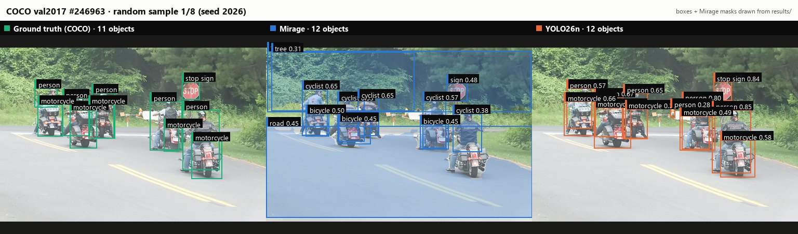
*A random image from the 300-image test set: COCO ground truth (green), Mirage boxes and masks (blue), YOLO26n (orange). Mirage calls the motorcycles "bicycle", the riders "cyclist" and the stop sign just "sign".*

**Watch:** [all 300 test images, side by side (5 min MP4)](media/video/coco300_gt_mirage_yolo.mp4) · [stability test, 8 scenes (1.5 min MP4)](media/video/stability_8_scenes.mp4) · [gallery](#gallery)

The evaluation used **still images only**. The videos step through those images; Mirage was not tested on real video.

## Verdict

**Not suitable as a humanoid's primary or safety-relevant perception, at least on the build tested.**
- It finds about a third of objects and people.
- About a third of its names are wrong.
- Its output changes between nearly identical frames.
- The stock Python API crashes on 18% of real photos.
- `extract()` (yes/no, count and free-text questions) gave answers that did not track the image.

**What works:**
- Reading clear signs through `describe()`.
- Masks for objects it does find.
- Rich scene and relation descriptions.
- A tiny memory footprint (~200 MB).

At most, use it as a slow, event-triggered scene describer or sign reader next to a real detector and tracker (for example YOLO26n).

## Test setup

| | |
|---|---|
| Model | `Cactus-Compute/mirage` weights rev `76c1e9e` (2-bit `.cact`, SHA-256 pinned by the package) |
| Runtime | `cactus-compute` 4.2.2, engine 4.1.1 (`win_amd64` wheel), CPU only; `CACTUS_TELEMETRY=0` |
| Baseline | Ultralytics YOLO26n (`yolo26n.pt`, ultralytics 8.4.214, torch 2.15 CPU) |
| Hardware | Intel i5-11320H (4 cores / 8 threads) laptop, Windows 11, 8 GB RAM |
| Data | 300 COCO val2017 images (seeded random sample, seed 1234; 2,287 non-crowd GT boxes) plus synthetic probes |
| Date | 2026-11-16 |

COCO is YOLO's training domain and Mirage uses open-vocabulary names, so the comparison favours YOLO. To reduce this, detection is scored class-agnostically, and names are checked separately.

## Results

### Detection: COCO val2017, 300 images
Class-agnostic recall at IoU 0.5 (did any predicted box overlap the GT object, regardless of name). Sizes are COCO small/medium/large.

| | Mirage | YOLO26n |
|---|---|---|
| Recall, all objects | **34.2%** | 50.6% |
| small / medium / large | 12.7 / 34.7 / 70.4 | 23.2 / 60.3 / 83.1 |
| Predictions per image | 10.1 | 4.95 |
| Name correct on matched boxes | 58.7% automatic, **~65%** after a hand audit of 80 mismatches (many were synonyms) | 96.5% |

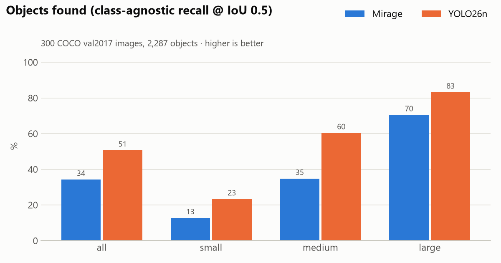

Mirage's `score` field rates the box, not the name. Only 10% of its boxes scored 0.3–0.4 match a GT object, versus 81% of those scored 0.8–0.9. The chart leaves out the 29 boxes whose score was NaN.

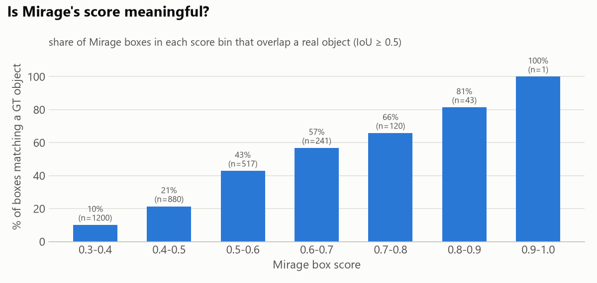

### People
| | Mirage | YOLO26n |
|---|---|---|
| Person instance recall / precision | **33.5% / 53.6%** | 58.6% / 82.2% |
| Recall: small / medium / large persons | 8.3 / 34.4 / 69.4 | 25.4 / 71.4 / 91.1 |
| Image has a person → reports any person | 87.4% (94.1% when a large person is present) | 92.5% (97.0%) |
| Reports a person in an image without one | 5.0% | 1.4% |

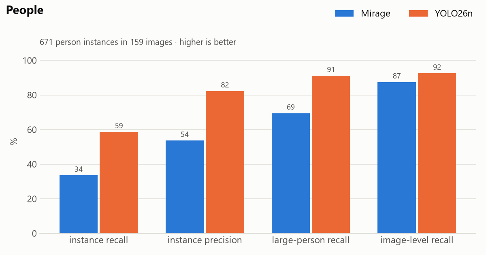

Of 5 person/furniture mix-ups inspected visually, 2 were real errors: a clearly visible adult labelled as furniture ("chair", "couch"). One of them is shown below (a selected example, not a random one):

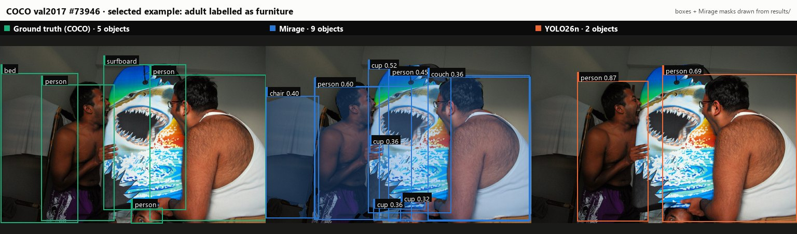

### Masks (Mirage only)
Mask IoU against COCO segmentation for 783 box-matched objects: mean **0.70**, median 0.74 (small objects 0.63; large 0.79 median). 48% of masks reach IoU ≥ 0.75.

### Frame-to-frame stability
8 scenes × 7 perturbations. "Box persistence" is the share of the original image's boxes that still appear (IoU ≥ 0.5) in the perturbed image.

| Perturbation | Mirage box / same-label persistence | YOLO26n box / same-label persistence |
|---|---|---|
| 2% pan | 58.7 / 46.0 | 90.0 / 90.0 |
| 5% pan | 43.5 / 27.4 | 94.3 / 94.3 |
| brightness ×0.75 | 61.9 / 52.4 | 97.2 / 97.2 |
| brightness ×1.25 | 61.9 / 44.4 | 97.2 / 97.2 |
| Gaussian blur | 58.7 / 34.9 | 73.6 / 73.6 |
| JPEG quality 35 | 61.9 / 41.3 | 80.6 / 80.6 |
| ⅓ resolution, upscaled | 54.0 / 27.0 | 72.2 / 72.2 |

Neither model flipped "a person is present" in any of these 8 scenes.

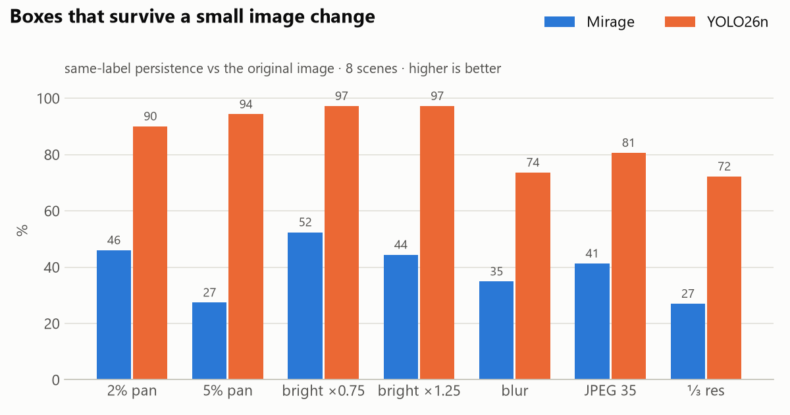

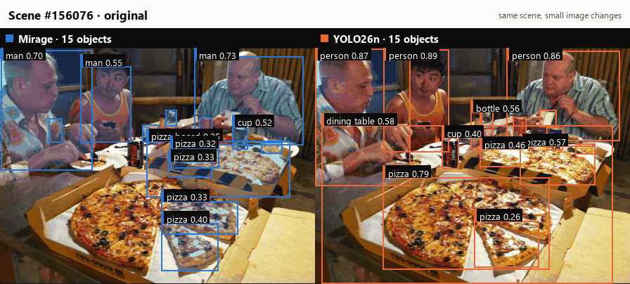

*Scene #156076 (the first of the 8 by id) cycling through the original and the 7 perturbations. The GIFs for all 8 scenes are in [`media/stability/`](media/stability/), and all 8 are in [this video](media/video/stability_8_scenes.mp4).*

### Blank and noise frames (hallucination)
6 synthetic frames: black, white, grey, gradient, noise, beige wall.
- **Mirage** had 3 clear failures:
  - It called the white frame a "hexagonal logo".
  - It called the black frame a "black square on white".
  - The flat grey frame produced a runaway "and and … f f f" text loop.
- **YOLO26n** had 1 failure: a "dog" on the noise frame.

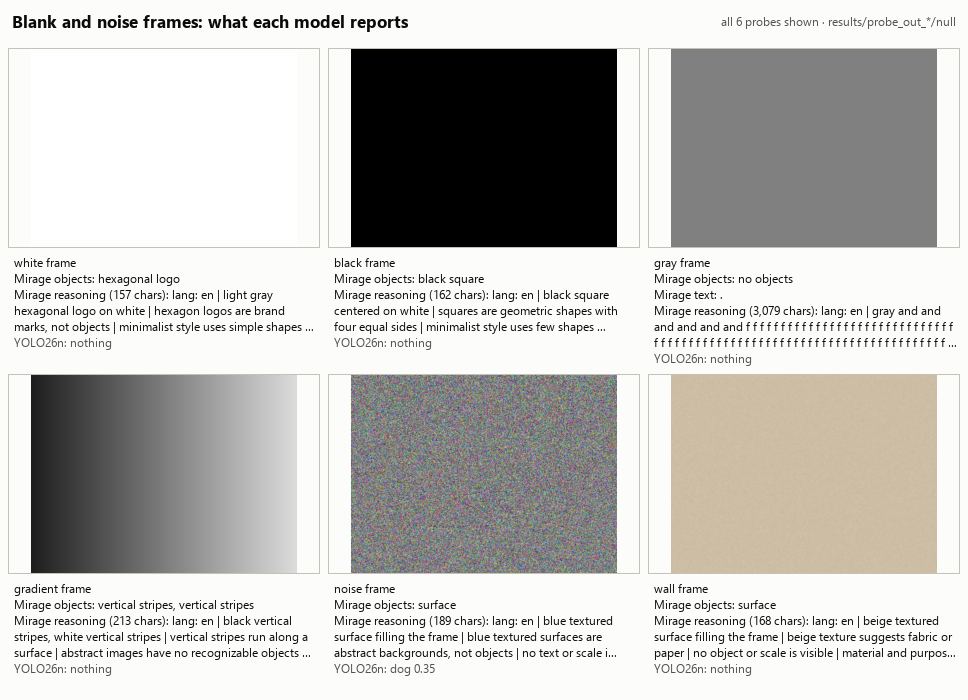

### OCR on synthetic signs (`describe()`)
8 sign texts ("EXIT", "WET FLOOR", "ROOM 204", …) pasted onto indoor photos. Exact reads:

| Size | Exact |
|---|---|
| Large | 100% |
| Medium | 100% |
| Small | 87.5% |
| Large, rotated 15° | 87.5% |

<details>
<summary>All 32 sign images with the describe() and extract() answers (tall image)</summary>

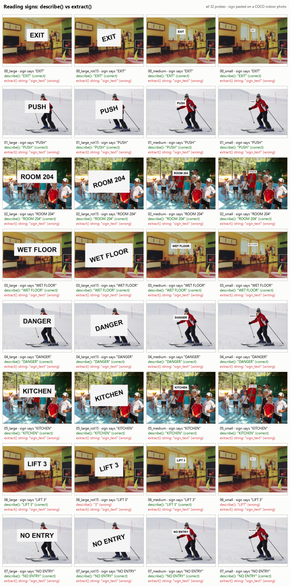

</details>

### `extract()` form filling
Each field is a question, in the documented form syntax, e.g. `{"animal": {"enum": ["dog", "cat"]}}`.

| Test | Result |
|---|---|
| `person_present` yes/no alone (60 images, 30 with people) | 25% correct, 9 abstained; inverted: "yes" on 9/30 with people but 19/30 without |
| Same field inside a 3-field form | always "yes" (50%); same answer as the solo form on 47% |
| Confidence of right vs wrong yes/no answers | 0.45 vs 0.46 alone, 0.76 vs 0.77 in the form, so a threshold cannot separate them |
| People count 0–10 (60 images) | "0" on all 60, at 94–99% confidence |
| `chair_present` (60 images, only 8 contain a chair) | abstained on 42; 8 of 18 answers correct |
| Reworded person fields (20 images, 10 with people) | `person`, `contains_people`: abstained on all 20; `is_there_a_person_in_the_image`: 8/11 answers right, 9 abstained; `subject` enum: "person" on 18/20 regardless |
| Vendor's own example `{"animal": {"enum": ["dog", "cat"]}}` (15 dog + 15 cat photos) | "dog" on all 30, in either option order; P(dog) 0.71 on dog photos vs 0.66 on cat photos |
| `describe()` on the same 30 photos (control) | right animal named in 19/30 |
| `{"type": "string"}` field on the 32 signs | 0/32: returns the field name ("sign_text") or unrelated words ("simple", "business name") at ~0.1% probability |

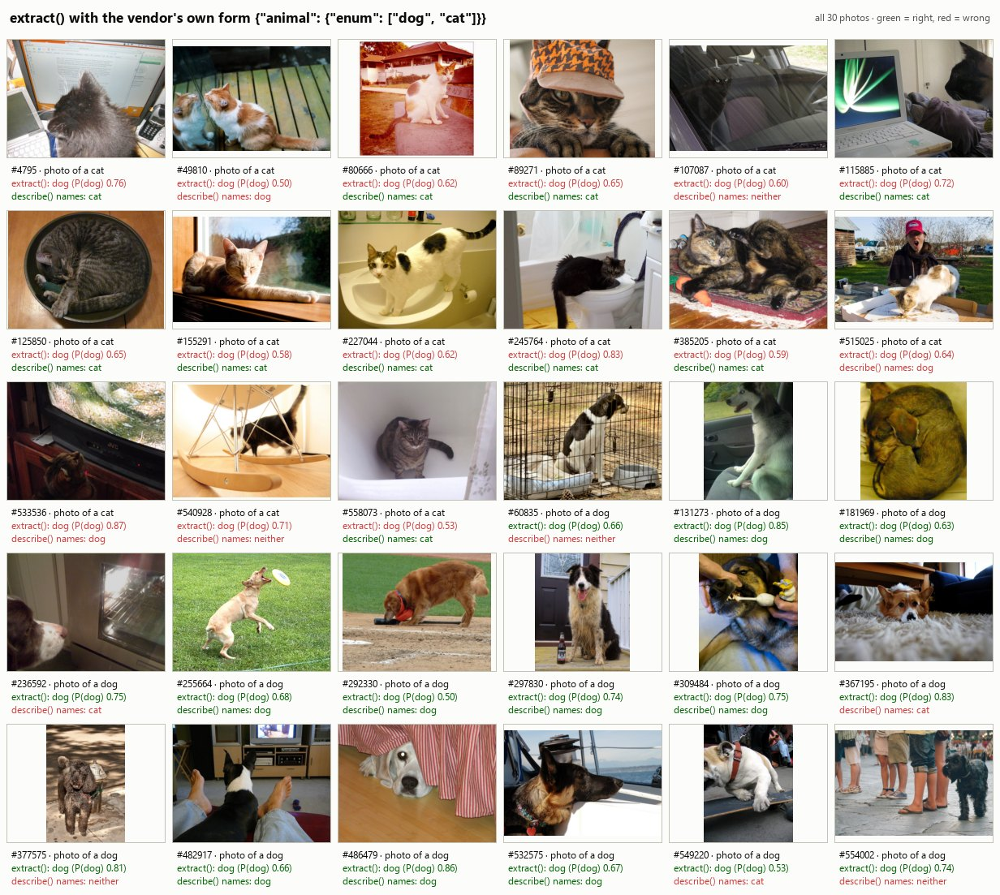

Depending on wording, `extract()` output was constant, inverted or abstained, while `describe()` saw the same images. Use `describe()` and post-process its output instead. Box-reference fields and ARM builds were not tested.

### Speed and resources (i5-11320H, warm median)
| Mode | Median | p90 |
|---|---|---|
| Full `describe()` | 1,495 ms | 1,783 ms |
| Objects only | 1,488 ms | 1,694 ms |
| Objects, bbox + score fields only | 1,393 ms | 1,556 ms |
| Text only | 1,390 ms | 1,475 ms |
| `extract()` one yes/no field | 1,099 ms | 1,175 ms |
| COCO run, end to end incl. JPEG decode | 1,749 ms | 2,443 ms |
| YOLO26n, same COCO run | 59 ms | 75 ms |

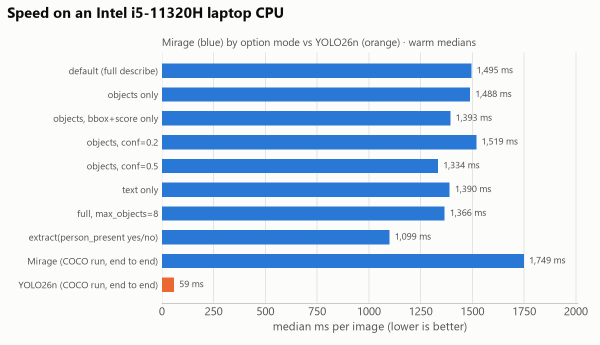

- **Threads:** `set_threads(1…8)` made no difference (1.8–2.1 s in that run). The engine keeps 5–6 of 8 logical cores busy regardless, so it cannot be throttled to leave room for SLAM or control.
- **Input size:** downscaling to 320–640 px wide before the call did not help (the model works on a fixed 512 px canvas).
- **RAM:** process RSS was ~123 MB after load and ~194 MB peak.
- **Determinism:** the same input gives the same output.
- **Vendor figures:** Cactus reports 77.5 ms on an unnamed CPU and 107 ms on a Galaxy S26 phone CPU ([release blog](https://cactuscompute.com/blog/mirage)). The gap with this laptop is unexplained and may be specific to the x86 Windows build. **Measure on your target board** with `eval/02_options_latency.py`.

## Bugs and quirks found (cactus-compute 4.2.2, engine 4.1.1, win_amd64)
1. **Invalid JSON crash.**
   - The engine sometimes prints a NaN score as `-nan(ind)`, so `Mirage.describe()` raises `JSONDecodeError`. This happened on **53/300 (17.7%)** COCO images.
   - `eval/mirage_safe.py` calls the engine directly and replaces non-finite numbers with `null`.
   - Objects with a NaN score land in the 0.0–0.1 score bin of `results/score_coco_mirage.json`.
2. **`extract()` answers do not track the image** (see above).
3. **`set_threads()` is ignored** by Mirage.
4. **Unknown option keys are silently accepted.** For example, `{"not_an_option": 1}` runs normally, so a typo in an option goes unnoticed. An unknown section name does raise an error.
5. **`id` in the output groups objects by class, not by instance,** and `relations` refer to these group ids. As a result, "person standing_on ocean" cannot be tied to one person.
6. **No tracking or video API, no depth output and no GPU path.**

### Using Mirage safely
```python
from mirage_safe import SafeMirage          # eval/mirage_safe.py
m = SafeMirage()
r = m.describe(frame_rgb_uint8)             # numpy HxWx3 uint8, PIL image, bytes or path
```
- `bbox` is `[x1, y1, x2, y2]` on a 0–1000 scale per axis.
- `mask` is a flat polygon on the same scale. `mask_format` can be `largest` (the default), `polygons`, `merged` or `bitmap`.

## Gallery
8 images drawn at random from the 300-image test set (seed 2026), not picked by hand. Green is COCO ground truth, blue is Mirage (boxes and masks), orange is YOLO26n. Every image is in [the 5-minute video](media/video/coco300_gt_mirage_yolo.mp4).

| | |
|---|---|
| 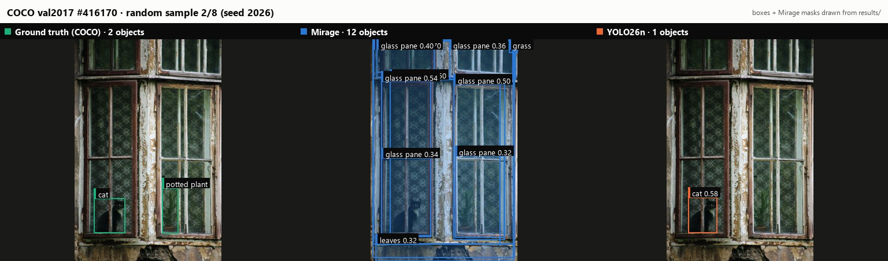 | 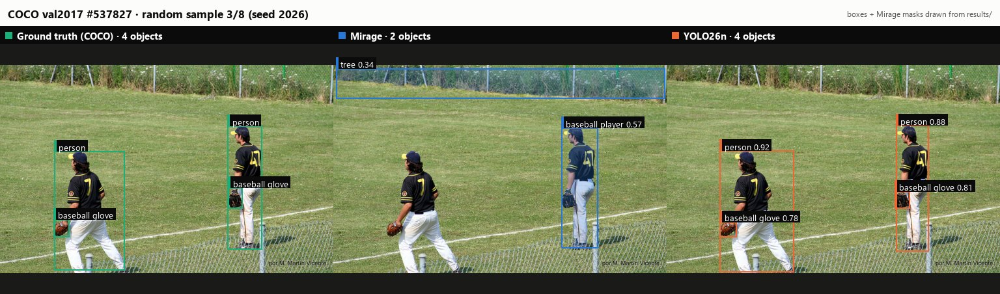 |
| 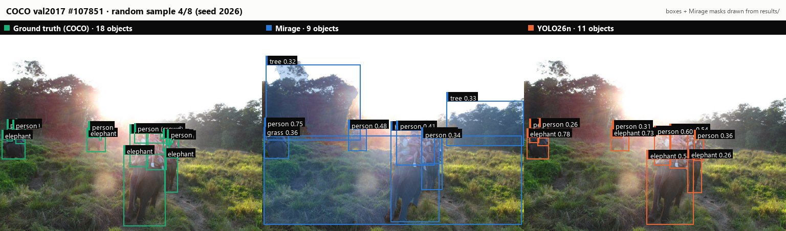 | 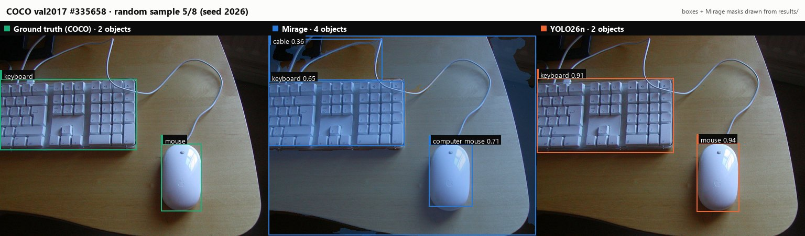 |
| 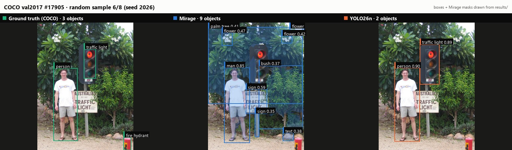 | 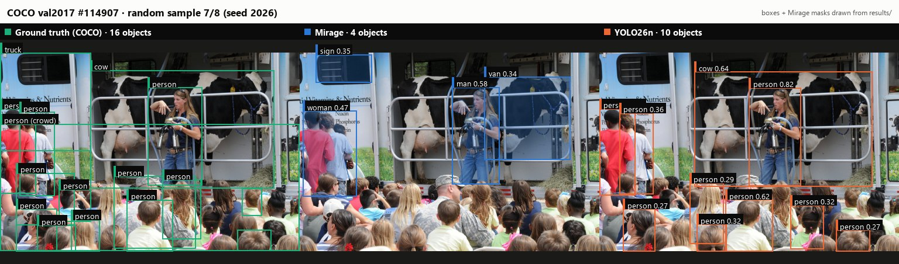 |
| 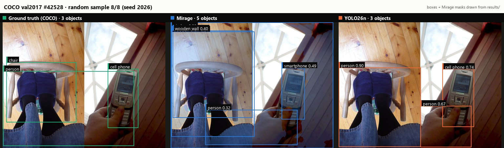 |  |

All figures and videos are drawn from the saved outputs by `eval/11_make_media.py`; no model runs in that step.

## Compare your own model
The scorers read one JSON file per image, so any detector can be added:

```
my_model_out/
  _sample_ids.json        # copy from results/coco_mirage/ (the 300 image ids)
  _index.jsonl            # optional, for latency: {"image_id": 139, "ms": 41.2, "error": null} per line
  139.json                # {"objects": [{"name": "person", "score": 0.91, "bbox": [x1, y1, x2, y2]}, ...]}
  ...
```

Write `bbox` on the **0–1000 per-axis scale**: pixel x / image width × 1000, pixel y / image height × 1000. `eval/04b_coco_run_yolo.py` is a 40-line example. Then:

```bash
python eval/05_coco_score.py <instances_val2017.json> my_model_out          # detection, people, names, latency
python eval/06c_score_probes.py results/probes results/probe_out_mirage my_probe_out   # null frames + stability
```
`06c_score_probes.py` reports the third argument under the label "yolo". `my_probe_out` needs `null/` and `stab/` subfolders, one JSON per probe image.

`results/coco_mirage/` and `results/coco_yolo26n/` contain the raw outputs behind every number above. Mirage's files are full `describe()` outputs, with masks, text, relations and reasoning.

## Reproduce
1. Download COCO val2017 from [cocodataset.org](https://cocodataset.org/#download): `val2017.zip` (images) and `annotations_trainval2017.zip` (for `instances_val2017.json`).
2. Set up the environments (Python 3.12; [uv](https://docs.astral.sh/uv/) shown, pip works too):
   ```bash
   uv venv .venv --python 3.12
   uv pip install --python .venv -r requirements.txt
   uv venv .venv-yolo --python 3.12
   uv pip install --python .venv-yolo -r requirements-yolo.txt --index-url https://download.pytorch.org/whl/cpu --extra-index-url https://pypi.org/simple
   export CACTUS_TELEMETRY=0        # PowerShell: $env:CACTUS_TELEMETRY='0'  (the package sends anonymous usage pings by default)
   ```
   `cactus-compute` downloads the engine and the pinned Mirage weights on first use. Ultralytics downloads `yolo26n.pt`.
3. Run the steps below with `.venv`'s Python. Steps marked YOLO use `.venv-yolo`'s Python. `VAL` is the val2017 image folder and `ANN` the path to `instances_val2017.json`:

| Step | Command |
|---|---|
| COCO run | `python eval/04_coco_run.py $VAL $ANN results/coco_mirage 300 1234` |
| COCO run (YOLO) | `python eval/04b_coco_run_yolo.py $VAL results/coco_mirage results/coco_yolo26n` |
| Score | `python eval/05_coco_score.py $ANN results/coco_mirage` (and `results/coco_yolo26n`) |
| Masks | `python eval/07_mask_iou.py $ANN results/coco_mirage` |
| Build probes | `python eval/06a_make_probes.py $VAL $ANN results/coco_mirage results/probes` |
| Run probes | `python eval/run_dir.py mirage results/probes/<null\|stab\|ocr> results/probe_out_mirage/<same>` (YOLO: `run_dir.py yolo …`) |
| Score probes | `python eval/06c_score_probes.py results/probes results/probe_out_mirage results/probe_out_yolo` |
| `extract()` | `06b_extract_eval.py`, then `06d_extract_fairness.py`, `06e_extract_order.py`, `06f_extract_ocr.py` (usage in each file's docstring) |
| Latency | `python eval/02_options_latency.py <folder of images> results/options_latency.json` |

On Windows, `eval/run_rest.ps1 -Val <dir> -Ann <file>` runs the probe and `extract()` steps in order.

**Bundled data.**
- **Photos:** the 329 COCO val2017 photos used here are in `data/coco_val2017/`. That covers the 300-image sample, the 30 dog/cat photos and the 3 sign backgrounds.
- **Ground truth and licences:** `data/coco_val2017_used.json` has the ground-truth boxes and each photo's licence and Flickr URL.
- **Probe images:** every probe image is in `results/probes/`.
- **Rerunning:** this is enough to run any model on exactly the same images and score it. The scripts that draw the samples (`04_coco_run.py`, `06a_make_probes.py`, `06b`, `06d`) still expect the full val2017 folder and `instances_val2017.json`, because they select images from the whole set.
- **Fonts:** the sign images were drawn with Arial Bold. If you regenerate them on a system without it, `06a_make_probes.py` falls back to DejaVu Sans Bold, or set `PROBE_FONT`.

## Repo layout
| Path | Contents |
|---|---|
| `eval/01–09_*.py` | Evaluation steps (each file's docstring gives its usage) |
| `eval/mirage_safe.py` | Crash-safe Mirage wrapper |
| `eval/run_dir.py` | Run Mirage or YOLO over a folder, saving one JSON per image |
| `eval/overlay*.py`, `08_relations_dump.py`, `09_label_audit.py`, `show_json.py` | Manual review aids |
| `eval/debug_raw.py`, `probe_extract.py`, `probe_boxref.py` | Small probes of the raw API |
| `eval/10_bundle_coco.py`, `eval/11_make_media.py` | Copy the used COCO photos with their licences; draw all figures and videos |
| `data/coco_val2017/`, `data/coco_val2017_used.json` | The 329 COCO photos used, with ground truth and per-photo licence |
| `media/` | Charts, gallery, stability GIFs, probe grids and the two MP4s |
| `results/score_*.json`, `mask_iou_mirage.json`, `extract_*.json`, `options_latency.json` | Scored results |
| `results/coco_mirage/`, `results/coco_yolo26n/` | Raw per-image outputs on the 300 COCO images |
| `results/probes/`, `results/probe_out_*/` | Probe images (blank frames, stability variants, signs) with `meta.json`, and raw outputs |
| `results/overlay_*.png`, `results/audit/` | Early overlays and the person/furniture audit images |

## Not tested
- Robot-eye (egocentric) views, real video, and real-world signs.
- ARM boards (Jetson, Raspberry Pi, phones), where the vendor's speed figures come from.
- `extract()` box-reference fields.
- Other small VLMs (e.g. Moondream 2, Gemma 4 E2B, LFM2.5-VL-450M) in the same "scene describer" role.

## License
- **Code, results and figures:** [MIT](LICENSE) © 2026 Shivpratap Singh Panwar.
- **COCO photos** (`data/coco_val2017/`, and the probe images and figures built from them): each photo keeps its own Flickr licence, listed per photo in `data/coco_val2017_used.json`. Several are non-commercial or no-derivatives licences.
- **COCO annotations:** CC BY 4.0, © COCO Consortium.

## References
- [Mirage model card](https://huggingface.co/Cactus-Compute/mirage) · [release blog](https://cactuscompute.com/blog/mirage) · [structured perception](https://cactuscompute.com/blog/structured-perception) · [instance segmentation](https://cactuscompute.com/blog/instance-segmentation) · [OCR decoding](https://cactuscompute.com/blog/ocr-decoding) · [Python docs](https://cactuscompute.com/blog/needle-python-docs)
- [cactus-compute on GitHub](https://github.com/cactus-compute/cactus) · [on PyPI](https://pypi.org/project/cactus-compute/)
- [COCO dataset](https://cocodataset.org/) (annotations CC BY 4.0; images under their Flickr licenses)
- [Ultralytics YOLO26](https://docs.ultralytics.com/)
